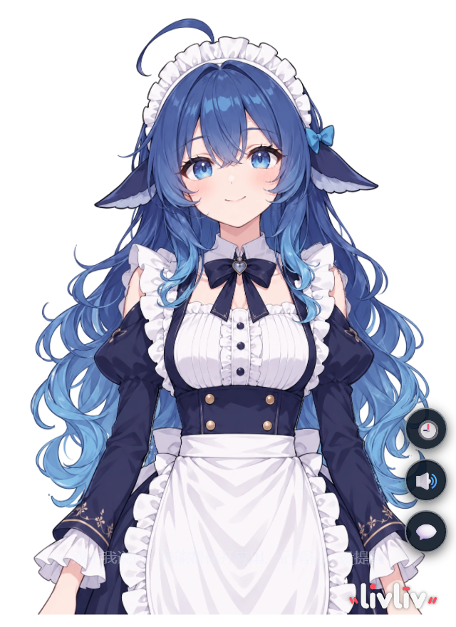
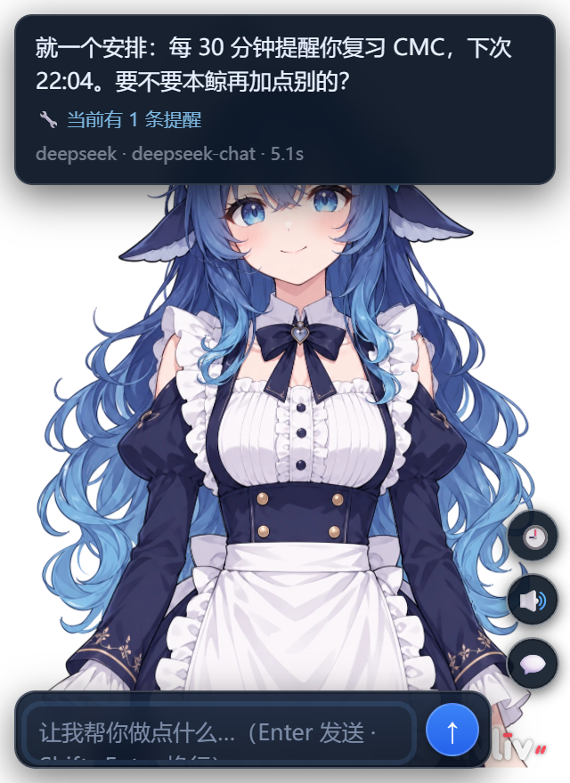
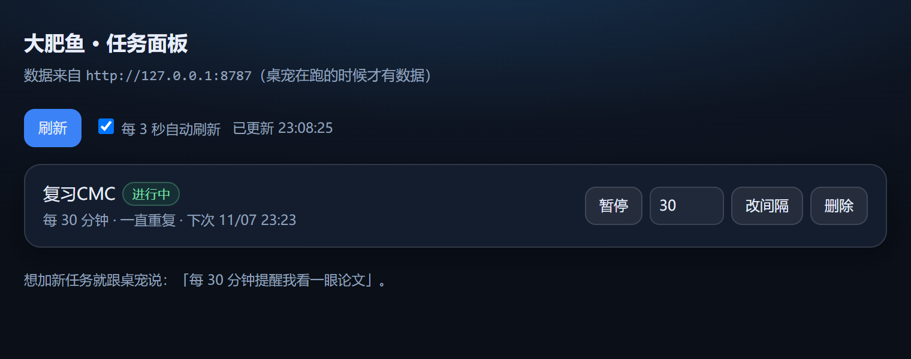

# Kujira Desktop Pet

A Windows desktop pet built on [livliv-dev/player](https://github.com/livliv-dev/player) (2.5D character rendering).
Frameless transparent window with speech synthesis and lip sync, multi-step AI tool calling, local vision and memory, reminders and a task panel.

- Rendering: LivLiv Player (WebGL2, `.livliv` character packages)
- Shell: Electron (frameless / transparent / always-on-top / tray / global hotkeys)
- Agent: local HTTP proxy (31+ tools, DeepSeek or local Ollama backends)

> This repository ships the shell, the pages and the tool proxy only.
> The character model and the upstream rendering library are not included.

---




## Features

| Module | Description |
|---|---|
| Desktop pet | Frameless transparent window, draggable, always on top, tray menu, global hotkeys |
| Speech | edge-tts Chinese voices, automatic fallback to system TTS; lip sync driven by real audio amplitude |
| Conversation | Bubble UI, multi-line input (Shift+Enter), cancel at any time, conversation history |
| Agent | 31+ tools: launch apps, read/write files, run Python, analyse pcap, weather, translation, web search, volume/media control, screenshots, simulated input |
| Multi-step | Up to 8 tool rounds per request, progress streamed to the page over SSE |
| Local AI | `bge-m3` vector memory, `qwen2.5vl` screen reading, reminders — all runnable offline |
| Task panel | Browser-based task manager: pause / resume / change interval / delete |

---

## Requirements

| Dependency | Notes |
|---|---|
| OS | Windows 10 / 11 (Win32 API and PowerShell are used) |
| Node.js | 18+ |
| Electron | Installed by `npm install` |
| Upstream player | Checked out next to this repo as `../player` |
| Chat backend | DeepSeek API key, or a local Ollama instance |
| Optional | Ollama with `bge-m3` (memory) and `qwen2.5vl:7b` (vision); Wireshark for pcap analysis |

---

## Installation

```powershell
# 1. Fetch the upstream rendering library (sibling directory)
git clone https://github.com/livliv-dev/player.git ..\player
cd ..\player
pnpm install
pnpm build
cd ..\kujira-pet

# 2. Install dependencies and deploy pages
.\setup.ps1
```

`setup.ps1` verifies `../player`, copies `pages/*.html` into `player/example/`, installs Electron and creates `config.json`.

### Configuration

```json
{
  "provider": "auto",
  "lang": "auto",
  "deepseekKey": "sk-...",
  "deepseekModel": "deepseek-chat",
  "ollamaUrl": "http://127.0.0.1:11434",
  "model": "qwen3.5:4b",
  "visionModel": "qwen2.5vl:7b",
  "embedModel": "bge-m3"
}
```

`deepseekKey` may be omitted in favour of the `DEEPSEEK_API_KEY` environment variable.

- `provider`: `auto` (cloud if a key exists, otherwise local) · `deepseek` (cloud only, frees VRAM for vision) · `ollama` (fully offline)
- `lang`: `auto` (mirror the user's language) · `zh` (Chinese) · `en` (English)

### Run

```powershell
npm start
```

The pet appears in the bottom-right corner and stays in the tray.

---

## Usage

### Hotkeys

| Hotkey | Action |
|---|---|
| `Ctrl+Alt+Space` | Reveal the pet (starts it if not running) |
| `Ctrl+Alt+T` | Open the task panel |
| `Ctrl+Alt+H` | Show / hide |
| `Ctrl+Alt+P` | Toggle click-through |
| `Ctrl+Alt+↑` / `↓` | Resize |
| `Ctrl+Alt+R` | Reload |
| `Ctrl+Alt+Q` | Quit |

### Interaction

| Action | Result |
|---|---|
| Double-click the canvas | Open the input bar |
| `Enter` | Send |
| `Shift+Enter` | New line |
| Click the send button while busy | Cancel the request |
| Drag the bubble edge / drag text | Move the bubble / select text |
| Right click | Cut, copy, paste, select all |
| 🔊 / 🕘 / 💬 | Voice toggle / history / input bar |

### Example prompts

```
What time is it?
Open Notepad and type: ship it tomorrow
Read D:\notes\weekly.md and summarise three points
Use run_python to sort data.csv by date and write sorted.csv
Analyse D:\capture.pcapng and list HTTP hosts and paths
What text is on my screen?
Remind me to check the paper every 30 minutes
```

---

## Project layout

```
kujira-pet/
├── app/
│   ├── main.js          Electron main process: window, tray, hotkeys, static server
│   ├── preload.js       Dragging, click-through, focus helpers
│   └── chat-proxy.mjs   Agent: tool schema and execution, SSE, TTS
├── pages/
│   ├── pet-chat.html    Main UI (chat / voice / history)
│   ├── pet-tasks.html   Task panel
│   ├── my-pet.html      Pet without chat
│   ├── pet-card.html    Card layout (for hosts without transparency)
│   └── wallpaper.html   Animated wallpaper
├── tools/
│   ├── win.ps1          Volume / media / screenshot / input / save-as
│   ├── winx.cs          Window enumeration, rect lookup, point clicks
│   └── PetHotkey.cs     Resident global-hotkey helper
├── assets/              Tray icons
├── docs/                Build notes (Chinese)
├── config.example.json
└── setup.ps1
```

---

## How it works

```
Electron main process
├── static server :8080 ── pages/*.html (renderer + UI)
└── agent        :8787 ── /chat (SSE) /convs /tasks /tts /reminders
```

1. The page sends `POST /chat?stream=1`; the proxy forwards the request to DeepSeek or Ollama.
2. When the model requests a tool, the proxy executes it locally (files, Python, PowerShell), feeds the result back and continues.
3. Each tool call is streamed to the page over SSE and rendered in the bubble.
4. The reply is stripped of emotion tags, then drives lip sync, expression and speech.

---

## Known limitations

- WeChat sending only supports “pick the chat manually → type → confirm → Enter”. Automatic contact search is unreliable (WeChat 4.x does not guarantee focus on `Ctrl+F`) and is disabled.
- Local vision models are unreliable at reading small on-screen text.
- `run_python` and `write_file` have real filesystem and network access; do not expose them to untrusted input.
- Windows only.

---

## FAQ

**Port already in use (8080 / 8787)**
Stop the conflicting process, or change `servePort` / `chatPort` in `config.json`.

**No sound**
Check the system volume and the 🔊 button. edge-tts requires network access; set `tts.engine` to `sapi` for offline use.

**`Failed to fetch`**
The proxy is starting up or was just restarted. Retry after a couple of seconds; otherwise inspect `pet-shell.log` and `chat-proxy.log`.

**WeChat message not sent**
Open the target chat manually, say “send to the current chat: <text>”, review the bubble prompt, then confirm.

**Out of VRAM**
Set `provider` to `deepseek` so the GPU is dedicated to vision, or use a smaller vision model.

---

## Data and privacy

- `config.json`, `data/` and `*.log` are excluded via `.gitignore`
- Conversation history lives in `data/conversations/*.json` and can be copied elsewhere
- Vision, memory and reminders are processed locally; only conversation content leaves the machine, according to the selected provider

---

## Credits and license

- Character rendering: [livliv-dev/player](https://github.com/livliv-dev/player)
- This project: MIT (see [LICENSE](LICENSE))
- Upstream library and character packages remain under their own licenses
