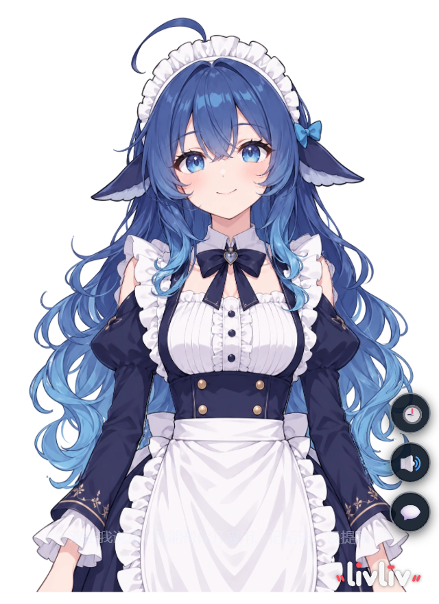
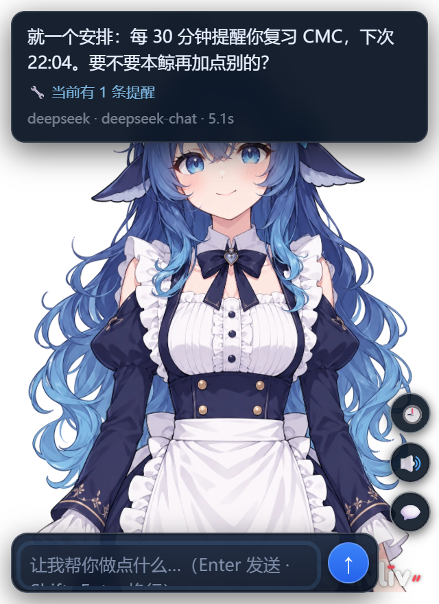
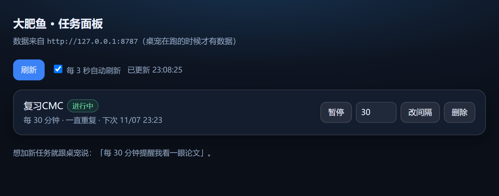

# 大肥鱼桌宠 · Kujira Desktop Pet

**简体中文** ｜ [English](README.en.md)

基于 [livliv-dev/player](https://github.com/livliv-dev/player) 2.5D 角色渲染的 Windows 桌面宠物。
透明无边框窗口，支持语音朗读与口型同步、多步 AI 工具调用、本地视觉与记忆、定时提醒与任务面板。

- 渲染层：LivLiv Player（WebGL2，`.livliv` 角色包）
- 外壳：Electron（无边框 / 透明 / 置顶 / 托盘 / 全局热键）
- 智能体：本地 HTTP 代理（31+ 工具，DeepSeek 或本地 Ollama 双后端）

> 本仓库不包含角色模型与上游渲染库，仅包含「外壳 + 页面 + 工具代理」。角色包请自行准备或从上游获取。

---




## 功能

| 模块 | 说明 |
|---|---|
| 桌面宠物 | 透明无边框窗口、可拖拽、置顶、托盘菜单、全局热键唤出 |
| 语音 | edge-tts 中文真人音色，失败自动降级系统语音；说话时口型随真实音频振幅变化 |
| 对话 | 气泡式对话，支持多行输入（Shift+Enter 换行）、随时中止、历史对话回看 |
| 智能体 | 31+ 工具：打开应用、读写文件、执行 Python、分析 pcap、查询天气、翻译、联网搜索、音量与媒体控制、截图读屏、模拟输入等 |
| 多步任务 | 单条指令最多 8 轮工具调用，执行过程以 SSE 实时回显 |
| 本地能力 | `bge-m3` 向量记忆、`qwen2.5vl` 视觉读屏、提醒与重复任务，均可离线运行 |
| 任务面板 | 浏览器打开的任务管理页：暂停 / 恢复 / 修改间隔 / 删除 |

---

## 环境要求

| 依赖 | 版本 / 说明 |
|---|---|
| 操作系统 | Windows 10 / 11（依赖 Win32 API 与 PowerShell） |
| Node.js | 18 或更高 |
| Electron | 由 `npm install` 自动安装 |
| 上游 player 库 | 与本仓库同级存放于 `../player` |
| 聊天后端 | DeepSeek API Key，或本地 Ollama（`qwen3.5:4b` 等） |
| 可选 | Ollama + `bge-m3`（向量记忆）、`qwen2.5vl:7b`（视觉）、Wireshark（pcap 分析） |

---

## 安装

```powershell
# 1. 取得上游渲染库（与仓库同级）
git clone https://github.com/livliv-dev/player.git ..\player
cd ..\player
pnpm install
pnpm build
cd ..\kujira-pet

# 2. 安装依赖并部署页面
.\setup.ps1
```

`setup.ps1` 会完成三件事：检查 `../player`、把 `pages/*.html` 复制到 `player/example/`、安装 Electron 并生成 `config.json`。

### 配置

编辑 `config.json`：

```json
{
  "provider": "auto",
  "deepseekKey": "sk-...",
  "deepseekModel": "deepseek-chat",
  "ollamaUrl": "http://127.0.0.1:11434",
  "model": "qwen3.5:4b",
  "visionModel": "qwen2.5vl:7b",
  "embedModel": "bge-m3"
}
```

也可以不写 `deepseekKey`，改用环境变量 `DEEPSEEK_API_KEY`。

`provider` 可选 `auto` / `deepseek` / `ollama`：

- `auto`：有 Key 走云端，没有则走本地
- `deepseek`：固定云端，本地显存全部留给视觉模型（推荐）
- `ollama`：完全离线

### 启动

```powershell
npm start
```

首次启动会在屏幕右下角出现桌宠，并常驻托盘。

---

## 使用

### 热键

| 热键 | 功能 |
|---|---|
| `Ctrl+Alt+Space` | 唤出桌宠（未运行则启动） |
| `Ctrl+Alt+T` | 打开任务面板 |
| `Ctrl+Alt+H` | 显示 / 隐藏 |
| `Ctrl+Alt+P` | 鼠标点击穿透 |
| `Ctrl+Alt+↑` / `↓` | 放大 / 缩小 |
| `Ctrl+Alt+R` | 重新加载页面 |
| `Ctrl+Alt+Q` | 退出 |

### 交互

| 操作 | 说明 |
|---|---|
| 双击画布 | 展开输入框 |
| `Enter` | 发送消息 |
| `Shift+Enter` | 换行 |
| 点击发送键（工作中） | 中止当前请求 |
| 拖动气泡边缘 / 拖动文字 | 移动气泡 / 选中文字 |
| 右键 | 剪切、复制、粘贴、全选 |
| 🔊 / 🕘 / 💬 | 语音开关 / 历史对话 / 输入框 |

### 指令示例

```
现在几点了
打开记事本，帮我打一行：今天的事明天再说
读一下 D:\notes\周报.md 并总结三点
用 run_python 把 data.csv 按日期排序，输出到 sorted.csv
分析 D:\capture.pcapng，列出 HTTP 请求的主机和路径
看一下屏幕上有什么字
每 30 分钟提醒我看一眼论文
```

---

## 目录结构

```
kujira-pet/
├── app/
│   ├── main.js          Electron 主进程：窗口、托盘、热键、内置静态服务
│   ├── preload.js       拖拽、点击穿透、焦点控制
│   └── chat-proxy.mjs   智能体：工具定义与执行、SSE 进度、TTS
├── pages/
│   ├── pet-chat.html    主界面（对话 / 语音 / 历史）
│   ├── pet-tasks.html   任务面板
│   ├── my-pet.html      无对话的纯桌宠
│   ├── pet-card.html    卡片式（用于不支持透明的宿主）
│   └── wallpaper.html   动态壁纸
├── tools/
│   ├── win.ps1          音量 / 媒体 / 截图 / 输入 / 另存为
│   ├── winx.cs          窗口枚举、矩形获取、定点点击
│   └── PetHotkey.cs     常驻热键小程序
├── assets/              托盘与图标
├── docs/                搭建与踩坑记录
├── config.example.json
└── setup.ps1
```

---

## 工作原理

```
Electron 主进程
├── 静态服务 :8080 ── pages/*.html（渲染层与 UI）
└── 智能体   :8787 ── /chat（SSE 流式）/convs /tasks /tts /reminders
```

1. 页面通过 `POST /chat?stream=1` 发起对话，代理将请求转发到 DeepSeek 或 Ollama。
2. 模型返回工具调用时，代理在本机执行（写文件、跑 Python、调 PowerShell 等），结果回填后继续推理。
3. 每个工具的执行进度通过 SSE 推回页面，显示在气泡中。
4. 回复文本经情绪标签清洗后返回，页面驱动口型、表情与语音。

---

## 已知限制

- 微信发送仅支持「人工选择会话 → 程序输入 → 人工确认 → 回车」。自动搜索联系人不可靠（微信 4.x 的 `Ctrl+F` 无法保证焦点），相关功能已停用。
- 本地视觉模型对屏幕小字识别不稳定，需要更强模型或人工确认。
- `run_python` 与 `write_file` 具备真实的文件系统与网络访问能力，请勿在不受信任的输入下使用。
- 仅支持 Windows。

---

## 常见问题

**端口被占用（8080 / 8787）**
关闭占用进程，或在 `config.json` 中修改 `servePort` / `chatPort`。

**没有声音**
检查系统音量与页面右下角 🔊 是否关闭；edge-tts 需要联网，离线时可在 `config.json` 将 `tts.engine` 改为 `sapi`。

**`Failed to fetch`**
代理未就绪或刚重启。等待两秒后重试；仍失败时查看 `pet-shell.log` 与 `chat-proxy.log`。

**微信消息发不出去**
先手动点开目标会话，再说「往当前聊天发：内容」，确认气泡提示后再回复「确定」。

**显存不足**
将 `provider` 设为 `deepseek`，把显存留给视觉模型；或改用较小的视觉模型。

---

## 数据与隐私

- 配置与运行时数据不进入版本库：`config.json`、`data/`、`*.log` 已在 `.gitignore` 中排除
- 对话历史保存在 `data/conversations/*.json`，可直接复制迁移
- 视觉、记忆、提醒均为本地处理；仅对话内容会按所选 provider 发送到云端

---

## 致谢与许可

- 角色渲染：[livliv-dev/player](https://github.com/livliv-dev/player)
- 本项目代码：MIT（见 [LICENSE](LICENSE)）
- 上游库与角色包版权归各自作者所有
